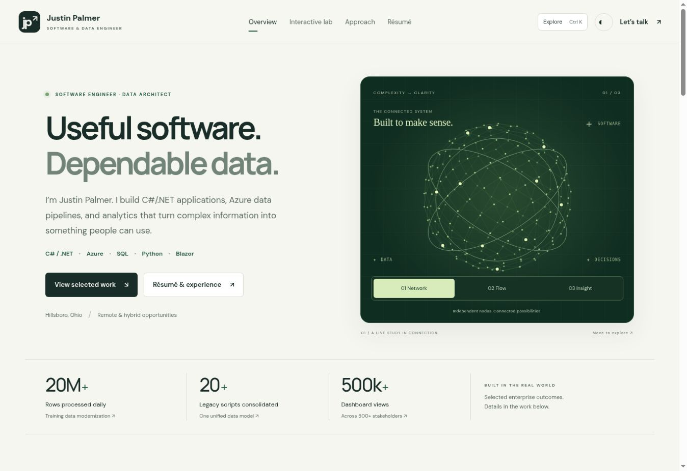

<div align="center">

# Justin Palmer

### Useful software. Dependable data.

Software engineering · Data platforms · Cloud architecture


**[Explore the site ↗](https://www.justinraypalmer.com/)** · [Interactive lab](https://www.justinraypalmer.com/visuals) · [Résumé](https://www.justinraypalmer.com/resume) · [Get in touch](mailto:justinraypalmer@gmail.com)

</div>

[](https://www.justinraypalmer.com/)

A portfolio for evaluating my software and data engineering work: project outcomes, my contribution, key design choices, interactive demonstrations, and a readable résumé. The public experience combines native browser graphics and thoughtful motion in a small static release for Azure Static Web Apps. The repository also retains the original ASP.NET Core/Blazor application.

Much of my professional work lives in federal environments. This repository provides a public example of how I turn engineering ideas into usable software; the demonstrations use synthetic data.

## Explore the experience

| Page | What to try |
| --- | --- |
| **[Overview](https://www.justinraypalmer.com/)** | Explore software, data, and analytics capabilities; read case studies; switch the Canvas sculpture between Network, Flow, and Insight; expand the event pipeline demo. |
| **[Interactive lab](https://www.justinraypalmer.com/visuals)** | Filter services and date windows, compare requests, average latency, and failures, copy a view link, and export the filtered CSV. |
| **[Approach](https://www.justinraypalmer.com/platform)** | Explore the experience, services, data, and integration layers of an architecture. |
| **[Résumé](https://www.justinraypalmer.com/resume)** | Read the web version, print it or save it as PDF through the browser, or download the Word document. |

**Across the site:** Ctrl/Cmd+K opens the search dialog, Escape closes it, and theme and motion preferences persist in the browser.

## Engineering highlights

- **Native browser graphics.** Canvas renders the morphing hero sculpture; SVG renders the dashboard charts. The public frontend requires no charting library or JavaScript framework.
- **Controlled animation.** The sculpture uses a single animation loop, targets roughly 30 fps, caps device pixel ratio at 1.75, and reduces point density for coarse pointers. Its loop stops when paused, off-screen, or in a hidden tab. OS reduced motion takes precedence.
- **Evidence before effects.** Role-specific capability panels connect skills to visible case studies, with contribution, design choices, and project-specific outcomes. Project summaries and navigation remain available without JavaScript.
- **Inspectable behavior.** The event playground exposes its contract and transformed output. Invalid amounts enter a quarantine path and skip downstream stages.
- **Shareable state.** Allowlisted URL parameters restore dashboard filters, sorting, and metric selection. CSV export uses the same filtered rows as the view.
- **Readable phone layouts.** A compact navigation disclosure, larger body text and controls, single-column résumé and case studies, and service metric cards keep the same content usable on narrow screens. Dashboard SVG geometry follows the chart container so axis text stays readable.
- **Progressive enhancement.** Main content and navigation are present in HTML. Skip navigation, labeled controls, native dialogs, and keyboard interactions support usability; JavaScript adds the interactive demos.
- **Small, self-hosted assets.** Scripts, styles, and DM Sans/Manrope fonts are served locally. Automated budgets limit the combined gzip size of the four frontend scripts to under 16 KiB and the stylesheet to under 14 KiB, excluding HTML, fonts, and other assets.

## How it is built

| Layer | Implementation |
| --- | --- |
| Public frontend | Four HTML pages, CSS, vanilla JavaScript, Canvas, SVG, native `<dialog>`, IntersectionObserver, and browser history/clipboard APIs. No frontend build step. |
| Static hosting | Azure Static Web Apps Free; explicit route rewrites preserve the public page URLs, with response headers defined in `staticwebapp.config.json`. |
| Existing application | Razor/Blazor Server and WebAssembly components, shared models, and earlier D3/Bootstrap assets remain in the solution. The current public pages use the native frontend above. |
| Retained .NET host | .NET 9 / ASP.NET Core, EF Core + SQLite, startup migrations/seeding, demo APIs, and health endpoints. These are available when running the original host locally; the static release contains only the public frontend and résumé download. |
| Demo data | The public dashboard generates its deterministic synthetic dataset in the browser. No database or server API is required by the static site. |
| Build and verification | A dependency-free Node packaging script; Node’s built-in test runner with JSDOM as a development dependency. No server process runs on the static host. |

### Source map

| Path | Purpose |
| --- | --- |
| [`MyPersonalSite/Program.cs`](MyPersonalSite/Program.cs) | Host configuration, public routes, APIs, and health checks. |
| [`wwwroot/portfolio/`](MyPersonalSite/wwwroot/portfolio) | Current public pages, styles, scripts, and licensed self-hosted fonts. |
| [`engine.js`](MyPersonalSite/wwwroot/portfolio/engine.js) | Pure event validation, dashboard URL parsing, and sculpture geometry. |
| [`app.js`](MyPersonalSite/wwwroot/portfolio/app.js) / [`modern.js`](MyPersonalSite/wwwroot/portfolio/modern.js) | Page interactions, dashboard rendering, search, animation, and event playground. |
| [`MyPersonalSite/Components/`](MyPersonalSite/Components) | Retained Razor/Blazor components. |
| [`MyPersonalSite/Data/`](MyPersonalSite/Data) | EF Core context and seed data. |
| [`MyPersonalSite.Client/`](MyPersonalSite.Client) / [`MyPersonalSite.Shared/`](MyPersonalSite.Shared) | Blazor WebAssembly project and shared types. |
| [`tests/`](tests) | Frontend contract, DOM integration, and asset budget checks. |
| [`scripts/build-static.mjs`](scripts/build-static.mjs) / [`staticwebapp.config.json`](staticwebapp.config.json) | Public asset packaging, static routes, and response headers. |

## Run locally

With **Node.js 20 or newer**, build and preview the static site:

```bash
git clone https://github.com/JustinPsHub/MyPersonalSite.git
cd MyPersonalSite
node scripts/build-static.mjs
npx --yes @azure/static-web-apps-cli start artifacts/static-site
```

Open **http://localhost:4280**. The preview uses the Static Web Apps emulator. The frontend demos need no external data service or API key.

<details>
<summary>Run the retained ASP.NET Core / Blazor host</summary>

Install the .NET 9 SDK, then run from the repository root:

```bash
dotnet restore
dotnet run --project MyPersonalSite --launch-profile http
```

Open http://localhost:5202. This host applies migrations and seeds its local SQLite database on startup. Use `dotnet watch --project MyPersonalSite --launch-profile http` for hot reload.

</details>

## Verify changes

With **Node.js 20 or newer**, run from the repository root:

```bash
npm --prefix tests ci --ignore-scripts
npm --prefix tests test
```

The suite covers event contracts and rejection paths, safe URL-state defaults, finite geometry, page initialization, search and keyboard actions, pipeline outcomes, dashboard totals, animation cancellation, reduced motion, compressed asset budgets, and links/assets in the packaged static release.

JSDOM checks behavior without a layout engine; Canvas, observers, and dialog opening are stubbed. Verify desktop/mobile layouts, native focus behavior, motion settings, and the browser console separately. These tests do not establish a Lighthouse score, Core Web Vitals result, or rendering frame rate. See [test details](tests/README.md) and [frontend implementation notes](docs/portfolio-modernization.md).

## Build and deploy

Build the public static release:

```bash
node scripts/build-static.mjs
```

Deploy the contents of `artifacts/static-site` to an Azure Static Web App on the **Free** plan using an authenticated deployment workflow. Include `staticwebapp.config.json` so page routes and security headers are applied. Keep deployment credentials in your hosting or CI secret store. After deployment, verify the four pages, interactive features, and résumé download. The static release needs no .NET server, database, or API deployment.

The Free plan has usage limits and no SLA. Domain registration and unrelated Azure resources are separate costs. The original .NET solution can still be built independently when needed.

## Demo data and confidentiality

The dashboard’s request counts, latency, failures, and deployment metrics are **deterministic synthetic data**, separate from the retained server demo APIs. The event pipeline is a local simulation; it does not send real orders or messages. Selected-work descriptions summarize professional experience without exposing production systems or employer telemetry. The Azure OpenAI/RAG case study describes prior work; it is not a live AI backend for this site.

---

**Justin Palmer** · [Website](https://www.justinraypalmer.com/) · [GitHub](https://github.com/JustinPsHub) · [Email](mailto:justinraypalmer@gmail.com)
